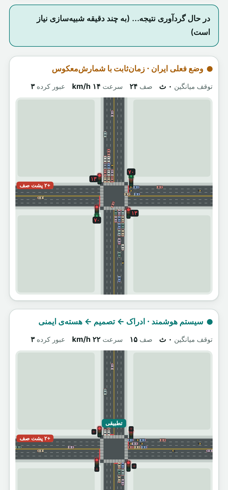
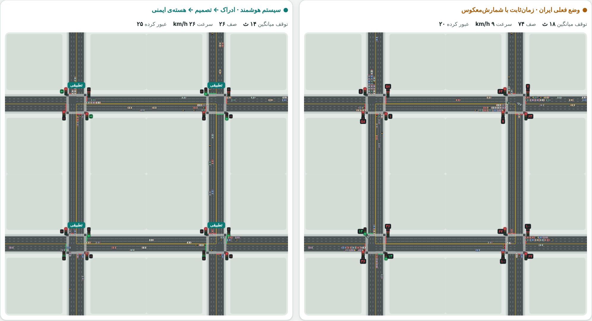

<div dir="rtl">

# 🚦 آزمایشگاه چراغ هوشمند — Smart Traffic Lab

**شبیه‌ساز زنده‌ای که چراغ زمان‌ثابتِ رایج در ایران را با یک سیستم هوشمند تطبیقی، روی «همان ترافیکِ تصادفی» مقایسه می‌کند.**
چهارراه، سه‌راه، کریدور سه‌چهارراه و شبکه ۲×۲؛ چپ محافظت‌شده (مثل مشهد)؛ آمبولانس، آتش‌نشانی و پلیس؛ و گزارش زنده‌ی «سیستم چرا این تصمیم را گرفت».

[](README.md)
[](tests/core.test.js)
[](LICENSE)
[](https://alireza-taheriF.github.io/smart-traffic-lab/)

### ▶ [آزمایشگاه زنده را همین حالا امتحان کنید](https://alireza-taheriF.github.io/smart-traffic-lab/)

[](docs/assets/demo.mp4)

<sub>روی تصویر کلیک کنید تا ویدیوی کامل (MP4) باز شود.</sub>

</div>

---

<div dir="rtl">

## چرا این پروژه؟

در بسیاری از چهارراه‌های ایران چراغ با برنامه‌ی ثابت کار می‌کند: چه صف باشد چه نباشد، چراغ چپ و مستقیم هرکدام زمان ثابتی می‌گیرند، آمبولانس باید پشت صف بایستد یا با ریسک از قرمز رد شود، و تمام‌قرمزِ بین فازها همیشه کامل اجرا می‌شود حتی وقتی تقاطع خالی است.

این مخزن یک **آزمایشگاه قابل اجرا** است که نشان می‌دهد با چند ایده‌ی مهندسی‌شده (که در دنیای واقعی هم قابل پیاده‌سازی‌اند) چه چیزی عوض می‌شود، و هر ادعا را با بنچمارک قابل تکرار می‌سنجد.

## نتیجه‌ی کلیدی

> در **چپ محافظت‌شده** (وضعیت مشهد)، کنترل‌کننده‌ی تطبیقی میانگین توقف هر خودرو را نسبت به چراغ زمان‌ثابت در حالت‌های **عادی، شلوغ، اشباع و بسیار شلوغ** حدود **۴۵ تا ۶۶٪** کم می‌کند؛ فقط در حالتِ قفل‌شدنِ تقریباً کامل یا سه‌راهِ بیش از ظرفیت، بهبود کمتر می‌شود (۳۷٪ و ۱۴٪) چون ظرفیت فیزیکیِ تقاطع تمام شده است.

| تقاطع | بار ۳۰۰ | ۵۰۰ | ۷۵۰ (ساعت اوج) | ۹۵۰ | ۱۱۰۰ (بسیار شلوغ) | ۱۳۰۰ (نزدیک قفل) |
|---|---:|---:|---:|---:|---:|---:|
| چهارراه | **۵۵٪** | **۴۹٪** | **۵۴٪** | **۵۴٪** | **۵۰٪** | ۳۷٪ |
| سه‌راه | **۶۶٪** | **۵۶٪** | **۵۱٪** | ۱۴٪ (بیش از ظرفیت) | — | — |
| کریدور ۳ چهارراه | **۶۱٪** | — | **۵۵٪** (بار ۶۰۰) | **۵۳٪** (بار ۹۰۰) | — | — |
| شبکه ۲×۲ | **۵۷٪** | — | **۵۲٪** (بار ۶۰۰) | **۴۵٪** (بار ۹۰۰) | — | — |

<sub>بار = خودرو در ساعت برای هر ورودیِ اصلی (شرق/غرب)؛ ورودی‌های شمال/جنوب ۶۵٪ آن. بهبود = کاهش میانگین زمان توقف هر خودرو، **با احتساب خودروهایی که هنوز در صف‌اند** (بدون سوگیریِ بازمانده). میانگین ۵ بذر تصادفیِ تازه که هرگز در تنظیم الگوریتم استفاده نشده‌اند. جدول کامل (صف، بیشترین انتظار، توان عبوری، حالت چپ آزاد) در [`docs/BENCHMARKS.md`](docs/BENCHMARKS.md).</sub>

**خودروی اورژانس** (چهارراه، چپ محافظت‌شده): آمبولانس در چراغ زمان‌ثابت ۲۹ تا ۴۶ ثانیه طول می‌کشد و در ۷ تا ۹ اجرا از ۱۲ اجرا مجبور به عبور ریسکی از قرمز می‌شود؛ با سیستم هوشمند ≈ ۲۰ تا ۲۳ ثانیه و تقریباً بدون توقف (کمتر از ۱٫۱ ثانیه)، بدون عبور از قرمز.

**ایمنی:** در تمام اجراهای بنچمارک هیچ‌گاه دو حرکتِ متقاطع هم‌زمان سبز نشدند (ستون Conflicts = ۰).

## تصاویر

| | |
|---|---|
|  |  |
|  |  |
|  |  |

<details><summary>نمای موبایل و شبکه ۲×۲</summary>

 

</details>

## الگوریتم تطبیقی (توضیح کامل)

سیستم در هر تقاطع هر **۱ ثانیه** یک بار چهار لایه را اجرا می‌کند. این لایه‌ها همان معماریِ پیشنهادیِ استقرار واقعی‌اند: ادراک ← تصمیم ← هسته‌ی ایمنی ← کنترلر.

```
حسگرها ──► ادراک ──► تصمیم‌گیر ──► هسته‌ی ایمنی ──► چراغ
 (دوربین/حلقه)  صف + اطمینان   فشار و gap-out     تنها راهِ رسیدن به چراغ
                    ▲                 ▲                  │
                    │            اولویت اورژانس          ▼
              ناظر (watchdog) ◄── اطمینان پایین ──► برگشت به برنامه‌ی ثابت
```

### ۱) ادراک
برای هر ورودی، خودروهای داخل ۱۳۰ متر را می‌شمارد: خودروی ایستاده ۱، خودروی در حال حرکت ۰٫۶. خودروهای نزدیکِ خط (≤ ۶۰ متر) جدا شمرده می‌شوند. در چپ محافظت‌شده، لاین چپ و لاین‌های مستقیم جدا اندازه‌گیری می‌شوند. هر ثانیه یک «اطمینان» (۰ تا ۱) هم تولید می‌شود. اگر حسگر خراب شود (گزینه‌ی «خرابی حسگر» در آزمایشگاه) اطمینان می‌افتد.

### ۲) فشار هر فاز (Max-Pressure با چند اصلاح)
فشار هر حرکت برابر است با

`فشار = صف دیده‌شده + سهم خودروهای در راه (پیام همسایه) − جریمه‌ی پربودنِ مقصد + انتظار / ۲۵`

* **سهم در راه:** خودروهای بالادستیِ تقاطع همسایه ۰٫۳ وزن می‌گیرند (هماهنگی کریدور، شبیه SURTRAC).
* **جریمه‌ی مقصد:** اگر مسیر پایین‌دست پر باشد، فشار کم می‌شود تا سیستم خودرو را به صفِ پر نفرستد.
* **انتظار / ۲۵:** هرچه خودرویی بیشتر منتظر بماند فشارش بیشتر می‌شود (انصاف).
فشار یک فاز = مجموع فشار حرکت‌هایی که آن فاز سبز می‌کند. در چپ محافظت‌شده چهار فاز داریم: شمال‑جنوب مستقیم/راست، شمال‑جنوب فقط چپ، و همین‌ها برای شرق‑غرب (سه‌راه: فاز ساقه‌ی «چپ و راست» یکی است).

### ۳) تصمیم: چه وقت فاز عوض شود؟
فازِ فعلی سبز است و بهترین فازِ دیگر (بیشترین فشار) نامزد است. در یکی از این حالت‌ها درخواست تغییر فاز داده می‌شود:

| قانون | شرط |
|---|---|
| **gap-out** | ۲ ثانیه هیچ خودرویی تا ۶۰ متریِ خطِ این فاز نیست و فشار نامزد > ۰٫۸ (برای فاز چپ > ۲٫۷) |
| **فشار** | فشار نامزد > ۲٫۲ × فشار فعلی + ۴ |
| **سقف سبز** | سبز ≥ ۶۸ ثانیه (چپ ۲۳) و فشار نامزد > ۰٫۵ |
| **ضد گرسنگی** | خودرویی ≥ ۱۳۰ ثانیه منتظر است و سبز فعلی ≥ ۳۰ ثانیه ← همان فاز |

فازِ بعدی ترتیب ثابت ندارد: اگر صف چپ خالی باشد فاز چپ **رد می‌شود** و زمان سبز به جهتی می‌رسد که واقعاً صف دارد.

### ۴) هسته‌ی ایمنی (تنها راه رسیدن به چراغ)
تصمیم‌گیر هرگز مستقیم چراغ را عوض نمی‌کند؛ فقط «درخواست» می‌دهد و هسته تأیید یا رد می‌کند:
* حداقل سبز: ۱۳ ثانیه مستقیم، ۱۰ ثانیه چپ (۵ ثانیه برای اورژانس)؛ زردِ ۳ ثانیه‌ای همیشه اجرا می‌شود.
* **تمام‌قرمز پویا:** تمام‌قرمز اسمی ۲ ثانیه است، اما وقتی حسگر تأیید کند تقاطع واقعاً خالی است، پس از حداقل **۱ ثانیه** سبزِ بعدی شروع می‌شود. (بزرگ‌ترین منبع بهبود؛ در جدول ablation ببینید.)
* ماتریس تعارض از هندسه‌ی مسیرها ساخته می‌شود و خودرویی وارد تقاطع نمی‌شود که مقصدش جا نداشته باشد («وسط تقاطع نایست»).

### ۵) اولویت اورژانس
شناسایی با **GPS امضاشده** (تا ۲۳۰ متر) یا با **گیت AND «دید + صدا»** (تا ۱۱۰ متر). پس از شناسایی: درخواست فاز مناسبِ حرکتِ همان خودرو (چپ/مستقیم/راست) ← زرد ← تمام‌قرمز ← سبز؛ تا عبور خودرو سبز می‌ماند (حداکثر ۴۵ ثانیه) ← بازگشت به کنترل عادی. هم‌زمانیِ چند اورژانس: اولویت با رتبه (آمبولانس = آتش‌نشانی > پلیس) و سپس نزدیک‌تر.

### ۶) ناظر (watchdog)
اگر اطمینان حسگر ۳ ثانیه زیر ۰٫۵ بماند، کنترل به برنامه‌ی ثابتِ فعلی برمی‌گردد و پس از ۱۰ ثانیه سلامتِ حسگر به حالت تطبیقی بازمی‌گردد.

### چراغ فعلی (خط پایه) چطور مدل شده؟
چرخه‌ی ثابت: شمال‑جنوب مستقیم ۳۵ ث ← فلش چپ ۱۲ ث ← شرق‑غرب مستقیم ۳۵ ث ← فلش چپ ۱۲ ث؛ زرد ۳ ث و تمام‌قرمز ۲ ث؛ شمارش‌معکوس. در حالت بدون چپ محافظت‌شده فقط دو فاز. اگر اورژانس بیش از ۵ ثانیه پشت قرمز بماند، با احتیاط رد می‌شود (و به‌عنوان «عبور ریسکی» شمرده می‌شود). همه‌ی زمان‌ها در رابط قابل تغییرند.

## هر بخش چقدر می‌ارزد؟ (ablation)
چهارراه، چپ محافظت‌شده، بهبود توقف:

| نسخه | بار ۷۵۰ | ۹۵۰ | ۱۱۰۰ |
|---|---:|---:|---:|
| الگوریتم کامل | **۵۴٪** | **۵۴٪** | **۵۰٪** |
| بدون تمام‌قرمز پویا | ۴۸٪ | ۴۰٪ | ۳۳٪ |
| بدون سبزِ آگاه از صف (فقط gap-out) | ۳۳٪ | ۲۵٪ | ۳۸٪ |
| سبز حداقلِ طولانی و تغییر فاز تنبل | ۳۱٪ | ۳۶٪ | ۵۰٪ |
| بدون وزن انتظار (ضدگرسنگی نرم) | ۴۷٪ | ۴۶٪ | ۴۹٪ |

دو نکته‌ی صادقانه: رد‌کردن فاز چپ و gap-out ریزتر در این شبیه‌سازی اثر قابل‌اندازه‌گیری نداشتند؛ و بهبود اصلی از «سبزِ آگاه از صف» و «تمام‌قرمز پویا» می‌آید.

## آنچه این پروژه **نیست** (محدودیت‌ها)
* داده‌ی واقعی مشهد را ندارد؛ **ارقام نسبیِ دو سیستم** روی ترافیک یکسان معنا دارند، نه عدد مطلق. زمان‌های خط پایه (۳۵/۱۲ ثانیه) فرضی‌اند؛ با زمان‌بندی واقعی یک تقاطع جایگزین کنید.
* ترافیک ناهمگن و بدون‌لاینِ واقعی، عابر پیاده، پارک دوبل و رفتار رانندگان مدل نشده‌اند (۱۳٪ موتور وجود دارد ولی لاین‌محور است).
* حسگرها ایده‌آل‌شده‌اند (۹۶٪ آشکارسازی با نویز ساده)؛ در دنیای واقعی کالیبراسیون لازم است.
* «بیشترین انتظار یک خودرو» در بعضی حالت‌ها نسبت به زمان‌ثابت **بدتر** می‌شود (مبادله‌ی انصاف با میانگین)؛ جدول BENCHMARKS همه را نشان می‌دهد.
* بالاتر از ظرفیت فیزیکی (سه‌راه با بار ۹۵۰ یا چهارراه بار ۱۳۰۰) هر دو سیستم صف می‌بندند و فقط ۱۴ تا ۳۷٪ بهبود باقی می‌ماند.

## راه‌اندازی و اجرا

نیازی به نصب وابستگی نیست (فقط Node ≥ 18).

```bash
git clone https://github.com/alireza-taheriF/smart-traffic-lab.git
cd smart-traffic-lab
npm test            # ۱۲ تست: ایمنی، تکرارپذیری، اورژانس، ناظر، بهبود ≥ ۴۰٪
npm run build       # docs/index.html را می‌سازد (صفحه‌ی خودکفا)
npm run serve       # http://localhost:8080
npm run bench       # بنچمارک سریع
npm run bench:all   # کل ماتریس + ablation + اورژانس + docs/BENCHMARKS.md
```

### ساختار
```
src/traffic-core.js      هسته‌ی خالص: شبکه، خودروها، ادراک، تصمیم، هسته‌ی ایمنی، اورژانس، ناظر
web/lab.template.html    رابط (canvas)، بدون وابستگی
docs/index.html          خروجیِ build (GitHub Pages)
bench/                   run.js (ماتریس)، ablation.js، emergency.js
tests/core.test.js       تست‌ها
scripts/                 build، report، capture (عکس و ویدیو با Playwright)
```

### به دنیای واقعی چطور وصل می‌شود؟
هسته به صفحه وابسته نیست. `perceive()` ← جعبه‌ی لبه‌ی کنار کنترلر (دوربین/رادار/حلقه)، تصمیم‌گیر ← سرویس روی همان جعبه، `request()` ← ماژول ایمنی در مسیر فرمان، خروجی ← NTCIP 1202 به کنترلر. پیشنهاد استقرار: **۱) فقط مشاهده** (تصمیم را حساب کن و با تصمیم کنترلر فعلی مقایسه کن)، **۲) مشورتی**، **۳) مستقیم** با ناظر سخت‌افزاری.

## نقشه‌ی راه
- [ ] واسنجی با داده‌ی شمارش مشهد و زمان‌بندی واقعی چراغ‌ها
- [ ] عابر پیاده و موتورهای بدون لاین
- [ ] تصمیم‌گیر RL (با همان هسته‌ی ایمنی و ماسک عمل)
- [ ] اتصال به SUMO برای مقایسه‌ی مستقل

## مجوز
MIT — ببینید [LICENSE](LICENSE).

</div>
