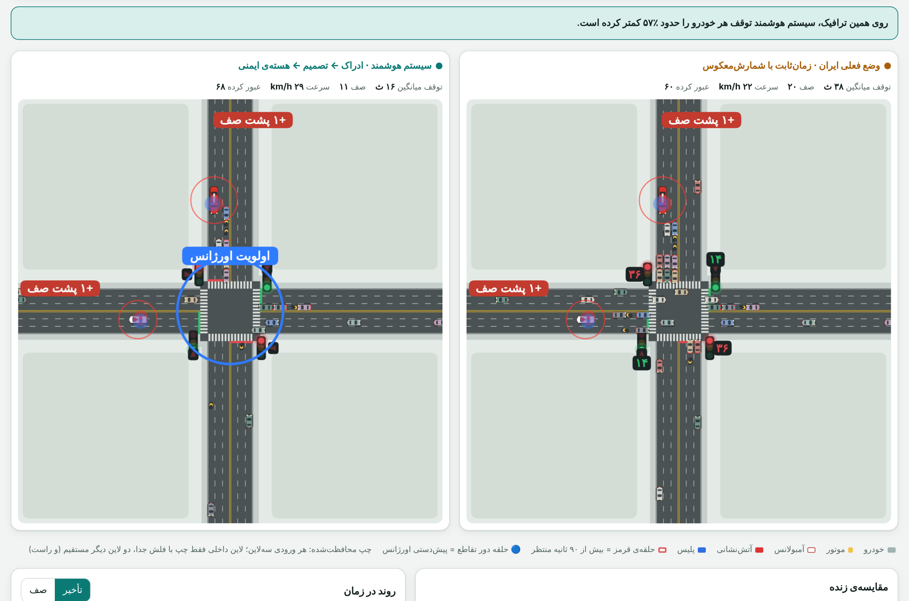
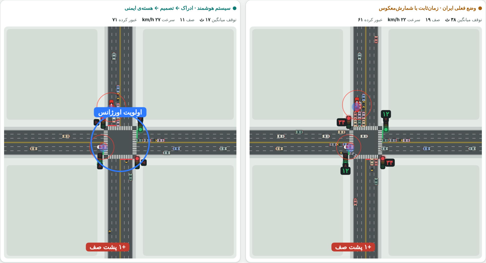
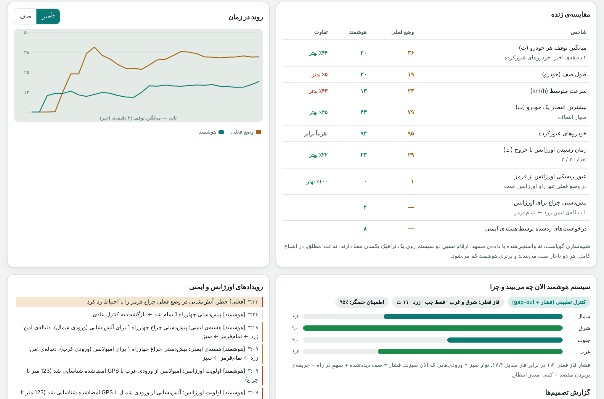
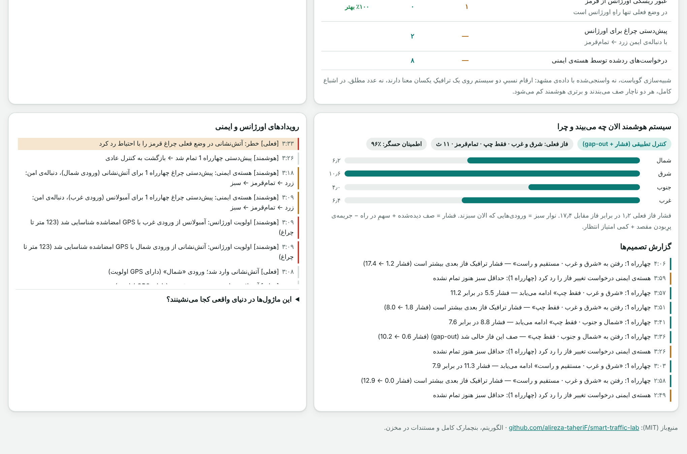
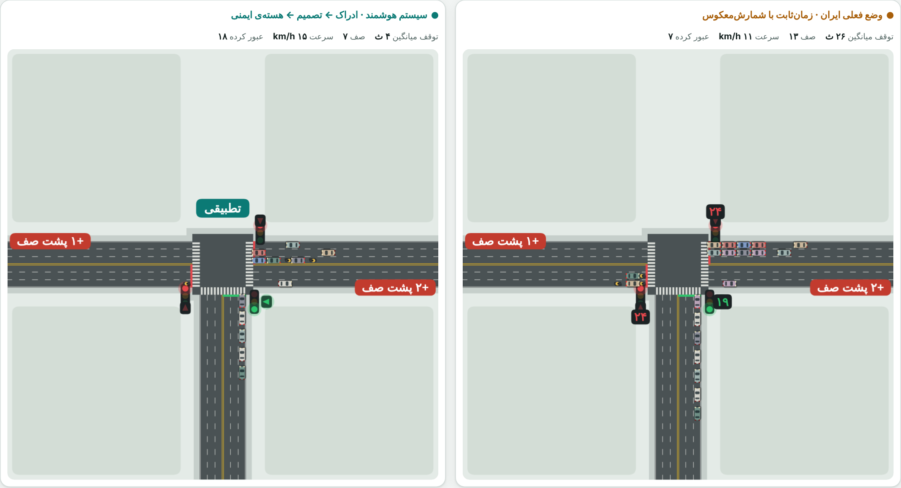
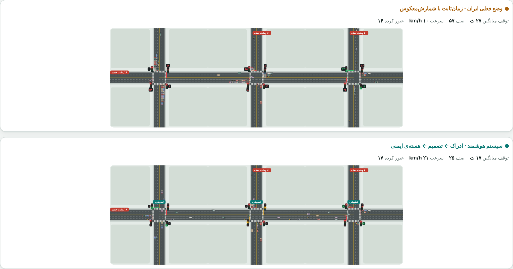

# 🚦 Smart Traffic Lab

**A live simulator that compares the fixed-time traffic signal common in Iran with an adaptive controller — on exactly the same random traffic.**
4-way, T-junction, 3-intersection corridor and 2×2 grid · protected left turns (as in Mashhad) · ambulance / fire truck / police preemption · a live "why did the system decide that" log.

[](README.fa.md)
[](tests/core.test.js)
[](LICENSE)
[](https://alireza-taheriF.github.io/smart-traffic-lab/)

### ▶ [Try the live lab](https://alireza-taheriF.github.io/smart-traffic-lab/)

[](docs/assets/demo.mp4)

<sub>Click the animation for the full MP4. The UI is in Persian (RTL); this README explains everything.</sub>

---

## Headline result

With **protected left turns** (dedicated left lane + left arrow, the Mashhad layout) the adaptive controller cuts the mean stopped time per vehicle by **≈45–66 %** versus the fixed-time baseline in normal, busy, saturated and very heavy traffic. Only at near-gridlock (37 %) or on a T-junction pushed beyond its physical capacity (14 %) does the gain shrink — there both controllers are capacity-limited.

| Layout | load 300 | 500 | 750 (rush hour) | 950 | 1100 (very heavy) | 1300 (near lock) |
|---|---:|---:|---:|---:|---:|---:|
| 4-way | **55 %** | **49 %** | **54 %** | **54 %** | **50 %** | 37 % |
| T-junction | **66 %** | **56 %** | **51 %** | 14 % (over capacity) | – | – |
| Corridor (3 junctions) | **61 %** | – | **55 %** (load 600) | **53 %** (load 900) | – | – |
| Grid 2×2 | **57 %** | – | **52 %** (load 600) | **45 %** (load 900) | – | – |

<sub>Load = vehicles/hour per main (east/west) entry; north/south get 65 %. Improvement = reduction of mean stopped time per vehicle **including vehicles still queued at the end** (no survivor bias). Mean of 5 fresh seeds never used for tuning. Full tables (queues, max wait, throughput, permissive-left mode): [`docs/BENCHMARKS.md`](docs/BENCHMARKS.md).</sub>

**Emergency vehicle** (4-way, protected left): under fixed-time an ambulance needs 29–46 s and had to run a red light in 7–9 of 12 runs; with the smart controller it needs ≈20–23 s, stops < 1.1 s and never runs a red light.

**Safety:** across every benchmark run, two conflicting movements were *never* green at the same time (`Conflicts = 0`).

## Screenshots

| | |
|---|---|
|  |  |
|  |  |
|  |  |

## How the adaptive controller works

Every second, at every intersection, four layers run (this is also the proposed real-world architecture):

```
sensors ─► Perception ─► Decider ─► Safety kernel ─► signal
 (camera/loop)  queues+confidence  pressure + gap-out   the only door to the lights
                     ▲                  ▲                       │
                     │            emergency priority            ▼
                Watchdog ◄── low confidence ──► fall back to the fixed plan
```

1. **Perception.** Per approach: vehicles within 130 m (stopped = 1, moving = 0.6), those within 60 m of the stop line counted separately, left-lane and through-lanes measured separately. A confidence value (0–1) is produced; sensor faults drop it.
2. **Pressure** of a movement group  
   `pressure = observed queue + 0.3·(vehicles approaching from the upstream neighbour) − downstream-spillback penalty + max_wait/25`  
   A phase's pressure is the sum over the movements it serves (Max-Pressure with neighbour messages à la SURTRAC and a fairness term).
3. **Decision.** The best other phase is a candidate; a change is *requested* when
   * **gap-out:** no vehicle within 60 m of this phase's stop lines for 2 s and candidate pressure > 0.8 (left phase: > 2.7), or
   * **pressure:** candidate > 2.2 × current + 4, or
   * **max green:** green ≥ 68 s (left 23 s) and candidate > 0.5, or
   * **anti-starvation:** a vehicle has waited ≥ 130 s and the current green is ≥ 30 s.
   Phase order is *not* fixed — an empty left-turn phase is simply skipped.
4. **Safety kernel (the only way to the lights).** Minimum green 13 s through / 10 s left (5 s for emergency), 3 s yellow always. **Dynamic all-red:** nominal 2 s, but ≥ 1 s once the sensor confirms the box is empty. A conflict matrix derived from path geometry, and "don't block the box" at the exit.
5. **Emergency priority.** Detection by signed GPS (≤ 230 m) or an AND-gate of sight + sound (≤ 110 m). The phase that serves that vehicle's movement is requested → yellow → all-red → green, held until it clears (max 45 s), then normal control resumes. Several emergency vehicles: rank (ambulance = fire > police), then proximity.
6. **Watchdog.** Confidence < 0.5 for 3 s → fixed-time plan; 10 healthy seconds → adaptive again.

**Baseline ("current Iran").** Fixed cycle N-S through 35 s → left arrow 12 s → E-W through 35 s → left arrow 12 s, 3 s yellow + 2 s all-red, countdown timers. An emergency vehicle stopped > 5 s at a red light crosses carefully (counted as a risky red-light run). All timings are adjustable in the UI.

### What each part is worth (ablation, 4-way, protected left)

| Variant | load 750 | 950 | 1100 |
|---|---:|---:|---:|
| full algorithm | **54 %** | **54 %** | **50 %** |
| without dynamic all-red | 48 % | 40 % | 33 % |
| without queue-aware green (gap-out only) | 33 % | 25 % | 38 % |
| long minimum green / lazy switching | 31 % | 36 % | 50 % |
| without the wait term | 47 % | 46 % | 49 % |

Skipping empty left phases and a finer gap-out had no measurable effect in this simulator; the gain comes mainly from queue-aware green lengths and dynamic all-red.

## Limitations (please read)

* **Not calibrated to real Mashhad data.** Only the *relative* numbers on identical traffic are meaningful. The baseline timings (35/12 s) are assumptions — replace them with a real intersection's plan.
* No pedestrians, double parking, lane-less heterogeneous traffic or driver behaviour (13 % motorcycles exist, but they are lane-based).
* Sensors are idealised (96 % detection with simple noise).
* "Max wait of one vehicle" can be **worse** than fixed-time in some cases (a fairness/average trade-off) — see `docs/BENCHMARKS.md`.
* Beyond physical capacity both controllers queue; the gain falls to 14–37 %.

## Run it

Node ≥ 18, no dependencies.

```bash
git clone https://github.com/alireza-taheriF/smart-traffic-lab.git
cd smart-traffic-lab
npm test            # 12 tests: safety, determinism, ambulance, watchdog, ≥40 % gain
npm run build       # builds docs/index.html (self-contained page)
npm run serve       # http://localhost:8080
npm run bench       # quick benchmark
npm run bench:all   # full matrix + ablation + emergency + docs/BENCHMARKS.md
```

```
src/traffic-core.js      pure core: network, vehicles, perception, decider, safety kernel, emergency, watchdog
web/lab.template.html    canvas UI (no dependencies)
docs/index.html          build output (GitHub Pages)
bench/                   run.js (matrix), ablation.js, emergency.js
tests/core.test.js       tests
scripts/                 build, report, capture (screenshots + video via Playwright)
```

### Towards the real world
The core is independent of the page. `perceive()` → an edge box next to the controller (camera/radar/loops); the decider → a service on the same box; `request()` → a safety module in the command path; output → NTCIP 1202 to the controller. Suggested roll-out: **1) observe-only** (compute decisions and compare with the real controller), **2) advisory**, **3) direct control** with a hardware watchdog.

## Roadmap
- [ ] Calibrate with real Mashhad counts and signal plans
- [ ] Pedestrians and lane-less motorcycles
- [ ] RL decider (same safety kernel + action mask)
- [ ] SUMO bridge for independent validation

## License
MIT
